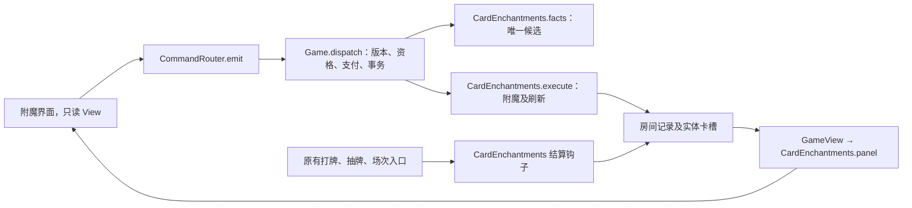

# 火堆附魔

2026-10-30 确认。附魔与原有火堆奖励可以组合使用，共用六回合预算；原有奖励仍只选一次。选择服务后停留在火堆菜单，点击开始休息才触发剩余的真实休息回合。

## 服务与卡牌归属

- 每个火堆成功附魔一次。先选词条，再选实体卡；普通花费2回合，稀有花费4回合。浏览、返回、取消不支付。
- 每张永久卡只有一个附魔槽，绑定两面；以后可替换，不能重复附上同一词条。基础卡可附魔，诅咒、状态及临时卡不可附魔。
- 入场冻结两个普通、一个稀有词条，不重复。仅抽取卡组内至少有一张适用牌的词条；某稀有度不足，用另一稀有度补位，仍不足则少展示。刷新可再次出现上轮词条。
- 每次刷新三个选项，不消耗回合。前3次每次10魔力，第4—6次20，第7—9次40，之后每3次翻倍。每个火堆重新计价。分别提供自身／魔瓶付款，不使用临时魔力，不合并余额。
- 费用资格读取牌面原始费用，不受本场折扣影响；X费按实际支付的X判定。至少一面符合即可附魔，只有符合的牌面触发对应效果。

## 词条

词条注册与玩家文案统一在 `spire-godot/data/card_enchantments.gd::TYPES`。

| 稀有度 | 词条 | 效果与资格 |
| --- | --- | --- |
| 普通 | 固有 | 开场优先入手，占正常起手名额；原有固有不可重复附加。 |
| 普通 | 保留 | 回合结束保留；原有保留不可重复附加。 |
| 普通 | 灵动 | 成功打出后额外抽1张牌。 |
| 普通 | 善变 | 非0费牌面：自由面恢复5自身魔力；拘束面获得1蓄力。 |
| 普通 | 熟练 | 仅魔法牌面，施法必定成功；身体条件与支付仍检查。 |
| 普通 | 播种 | 仅能力牌，打出后获得1能量。 |
| 普通 | 强化 | 打出后获得1临时力量、1临时灵巧，当前回合结束清除。 |
| 普通 | 强力 | 仅挣脱伤害牌；最终挣扎／滑脱／魔法滑脱伤害×1.5，包括捕缚、连段与波及；降紧和解锁不变。 |
| 普通 | 回收 | 非能力、两面均无原生消耗的牌可附魔；每场成功打出后回手1次，满手改入弃牌堆。 |
| 稀有 | 吸收 | 每场第一次成功打出后恢复20自身魔力。 |
| 稀有 | 播种 | 原始费用至少2的技能牌面，打出后获得1能量。 |
| 稀有 | 祝福 | 仅能力牌，打出后获得2力量、2灵巧，持续至整备结束，可叠加。 |
| 稀有 | 复放 | 额外免费释放1次；两面唯一不可附魔，单面唯一只屏蔽该面。沿用原有复放的目标、施法与叠加规则。 |
| 稀有 | 消耗 | 非能力牌。原本两面都无消耗则第一次打出即消耗；任一面有原生消耗则获得消耗2，第一次弃置、第二次消耗，两面共用次数。 |
| 稀有 | 回收2 | 回手2次，资格及满手规则与回收相同。 |
| 稀有 | 迅捷 | 每场第一次成功打出后抽3张牌。 |
| 稀有 | 枢纽 | 真正抽到此牌时获得1能量；起手和检索计入，生成、复制、回手不计。再次抽到可再次触发。 |

## 结算边界

- 原卡成功及其连段、复放结束后，触发一次打出附魔。施法失败不触发、不消耗附魔次数。非能力牌仍在使用中区时先结算附魔抽牌，再决定去向，不能被自己的附魔抽到。
- 复放不重复支付、不重复移动实体牌、不额外触发打出附魔。与已有复放次数相加；目标失效跳过。选择消耗的原目标已在消耗区时，也按失效跳过，不要求玩家另选三张。
- 回收与消耗2按实体牌计数，双面共用。回收次数用完后隐藏其关键词；消耗2用过一次后两面显示消耗。强制消耗、虚无不受这两个词条阻挡。
- 每场次数适用于战斗、休息、监狱。战斗进入战后整备、检查暂停均不重置；真正场次结束清理，下一场重新开始。复制继承附魔和本场已用次数，替换附魔清除旧槽的运行次数。

## 实现边界与验证

- 房间字段 `enchantments` 保存已用标记、刷新次数、冻结词条；`rest_reward_used` 保存原有奖励是否已选。实体卡字段 `enchantment` 保存永久槽，`enchant_used`、`enchant_pending` 保存本场成功次数与待结算牌面。老存档在火堆选择阶段恢复时补建选项，不改变调用者快照。
- `spire-godot/core/card_enchantments.gd` 负责资格、服务事实、附魔写入、结算钩子和只读投影；它不新增第二套打牌或支付通道。`spire-godot/core/game.gd::_mana_payment` 统一支付；`spire-godot/core/card_effects.gd::settle_played_card` 统一收尾。
- 界面仅保存当前词条选中状态，候选与支付取 View。附魔／次数改变通过既有 `face_effects`、`face_keywords`、`face_casting` 和实例投影使单卡缓存失效；火堆选项改变使奖励面板重建。原生消耗与附魔消耗2由稳定词条ID及 `show_exhaust` 控制，卡面不重复显示。没有新增装备遍历。
- 监狱固定路线仍逐字段校验，仅在比较静态路线前剔除已独立验证的火堆服务进度；使用途中火堆不会破坏出口战斗存档。
- 定向判据：`spire-godot/tests/enchantment_cases.gd::run`；真实指针选择、刷新和提交：`spire-godot/tests/enchantment_ui_cases.gd::run`。上游与下游回归范围登记在 `spire-godot/tests/suite_selection.gd::CROSS_AREAS`。文案简洁度与界面视觉仍靠人工检查。
