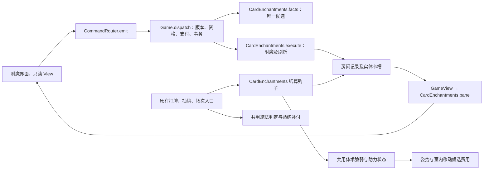

# 火堆附魔

每个火堆可以给牌组中的一张实体卡附魔一次。附魔跟随这张牌，自由面和拘束面共用一个槽。同名的其他卡各自独立。

## 在火堆附魔

1. 进入火堆时，从牌组有牌适用的词条中抽取 **2 个普通、1 个稀有**。同一轮按词条去重。某个稀有度不足时由另一个稀有度补位，两边都不足时只展示现有选项。选项随存档保留。
2. 先选词条，再选卡。确认时普通附魔花 **2 回合**，稀有附魔花 **4 回合**。浏览和返回免费。每个火堆基础为 6 回合，常规奖励也占用这份预算且限选一次。例如，先花 3 回合领取奖励，再花 2 回合附普通词条，还能休息 1 回合。点击「开始休息」才进入剩余回合。
3. 确认附魔前可刷新整组词条，可能再次抽到上轮的选项。刷新不消耗回合，但至少要剩 2 回合且牌组中仍有可附魔的牌。每个火堆单独计价，第 1—3 次每次 10 魔力，第 4—6 次 20，第 7—9 次 40，之后每 3 次翻倍。每次从自身魔力或魔瓶任选一个来源全额支付。临时魔力不能支付。

## 哪些牌可以附魔

- 永久卡（含基础卡）可以附魔，诅咒、状态牌和临时卡除外。以后在其他火堆可用新词条替换旧词条，并清除旧词条的使用次数。同一张牌不能重复附上当前词条。
- 有牌面限制的词条，只要一面符合就能附上，实际打出时按所用牌面判断。例如，原始费用一面为 1、另一面为 0 的牌可以附「善变」，只有 1 费面触发。
- 固定费用看牌面原始能量费用，本场减费不影响资格。X 费看本次实际支付的 X。

## 词条

共 20 个词条，普通 11 个、稀有 9 个。「播种」和「灵动」在两个稀有度中各占一项。注册与玩家文案见 `spire-godot/data/card_enchantments.gd::TYPES`。下表中的「打出」均指成功打出这张牌。

### 普通

| 词条 | 适用条件 | 效果 |
| --- | --- | --- |
| 固有 | 无原生固有 | 开场优先进入手牌，占一个正常起手名额。 |
| 保留 | 无原生保留 | 回合结束时留在手中。 |
| 灵动 | 原始费用大于 0 的牌面 | 打出后抽 1 张牌。 |
| 回收 | 非能力牌，且两面均无原生消耗 | 每场第一次打出后回手，满手时进入弃牌堆。 |
| 善变 | 原始费用大于 0 的牌面 | 打出自由面恢复 5 自身魔力，打出拘束面获得 1 层蓄力。 |
| 播种 | 能力面 | 打出后获得 1 能量。 |
| 熟练 | 有施法判定的魔法面 | 首次判定失败时，再支付该面的原始耗魔，使这次施法成功。 |
| 强化 | 通用 | 打出后力量、灵巧各 +1，持续至本回合结束。 |
| 强力 | 有挣脱伤害的牌 | 该牌最终的挣扎、滑脱、魔法滑脱伤害 ×1.5，含对捕缚的伤害、连段和波及。降紧与解锁不受加成。 |
| 猛攻 | 通用 | 自由面使下一次体术在全部段数结算后给所命中的存活目标施加 2 层脆弱，多次获得的猛攻累加在同一次体术上。拘束面使身上所有拘束具和特殊装备获得 2 层脆弱。 |
| 助力 | 通用 | 打出附有助力的这张牌额外消耗 5 魔力。本回合切换姿势、室内向墙或离墙移动、牢房探索移动免费。姿势顺序、步幅、路线与捕缚限制照常。 |

### 稀有

| 词条 | 适用条件 | 效果 |
| --- | --- | --- |
| 吸收 | 通用 | 每场第一次打出后恢复 20 自身魔力。 |
| 灵动 | 通用 | 打出后抽 1 张牌，0 费面也生效。 |
| 迅捷 | 通用 | 每场第一次打出后抽 3 张牌。 |
| 枢纽 | 通用 | 每回合首次抽到此牌获得 1 能量。本回合成功打出此牌一次后，每次抽到它都获得 1 能量。起手和检索抽牌都算，直接生成、复制入手和回手不触发。 |
| 回收2 | 与普通「回收」相同 | 每场前两次打出后回手，满手时进入弃牌堆。 |
| 播种 | 原始费用至少 2 的技能面 | 打出后获得 1 能量。 |
| 祝福 | 能力面 | 打出后力量、灵巧各 +2，持续至本场整备结束。多次触发可累积。 |
| 复放 | 至少有一个非唯一面 | 每场首次打出非唯一面时，免费额外释放一次。两面共享本场次数。 |
| 消耗 | 非能力牌 | 原本两面都无消耗，首次打出即消耗。任一面自带消耗，则第一次打出后弃置，第二次打出后消耗，两面共计。原生「消耗2」仍按两次结算。 |

## 结算边界

- 打出附魔在原卡成功及其连段、复放结束后触发一次。非能力牌先结算附魔抽牌，再决定去向。助力的额外魔力走出牌支付，进入牌面及候选报价。耗尽魔力的牌把额外 5 魔力计入最低可用魔力要求。
- 熟练先照常判定成功率。失败后如果剩余自身魔力和魔力预备足以支付牌面原始耗魔，按通常优先级补付，直接成功，不再掷骰。魔力不足仍走通常失败、返还与留牌。无可用施法部位仍不能施法。耗尽魔力的牌按原施法实际耗魔核算补付金额。复放沿用免费释放的规则。
- 复放沿用原牌面、目标与 X 值，与已有复放次数相加。额外释放免费，魔法重新判定施法成功率。失效目标跳过，已选作消耗的牌也不会要求重选。实体牌只移动一次，打出附魔也只触发一次。
- 复放、回收与消耗2按实体牌计数，双面共用。复放在第一次成功打出适用面并安排额外释放时计次。回收次数用完后隐藏其关键词；消耗2用过一次后两面显示消耗。强制消耗、虚无不受这两个词条阻挡。
- 每场次数适用于战斗、休息、监狱。战斗进入战后整备、检查暂停均不重置，下一场重新开始。复制继承附魔和本场已用次数，枢纽副本单独判定本回合的首抽和出牌。替换附魔清除旧槽的运行次数。

## 实现边界与验证

- 房间字段 `enchantments` 保存已用标记、刷新次数、冻结词条，`rest_reward_used` 保存原有奖励是否已选。实体卡字段 `enchantment` 保存永久槽，`enchant_used`、`enchant_pending` 保存本场适用次数与待结算牌面。活跃牌堆以 `enchant_nexus_tick` 记录枢纽最近触发的回合，以 `enchant_nexus_played_tick` 记录成功打出的回合。打出标记与当前回合相符时，重复抽到可继续回能。旧档继续识别原灵动词条 ID，使用稀有版效果。没有枢纽回合标记的旧卡使用首次触发规则。
- `spire-godot/core/card_enchantments.gd` 负责资格、服务事实、附魔写入和结算钩子。`spire-godot/core/card_effects.gd::face_mana` 产生含助力的支付报价，`spire-godot/core/game.gd::_mana_payment` 分配支付来源。`spire-godot/core/game.gd::_cast_magic` 在共用失败处理前结算熟练，`spire-godot/core/card_effects.gd::settle_played_card` 统一收尾。`spire-godot/core/card_effects.gd::consume_attack_buffs` 结算猛攻的体术脆弱。助力状态由 `spire-godot/core/game.gd::wall_movement_profile` 和 `spire-godot/core/game.gd::posture_facts` 读取。
- 界面仅保存当前词条选中状态，候选与支付取 View。附魔费用和状态沿 `face_mana`、`face_effects`、`face_keywords`、`face_casting` 和实例投影刷新。火堆选项改变使奖励面板重建。原生消耗和附魔消耗2由 `spire-godot/core/card_enchantments.gd::native_exhaust_display` 和 `spire-godot/core/card_enchantments.gd::text` 投影。
- 监狱固定路线仍逐字段校验，仅在比较静态路线前剔除已独立验证的火堆服务进度；使用途中火堆不会破坏出口战斗存档。
- 定向判据：`spire-godot/tests/enchantment_cases.gd::run`；真实指针选择、刷新和提交：`spire-godot/tests/enchantment_ui_cases.gd::run`。上游与下游回归范围登记在 `spire-godot/tests/suite_selection.gd::CROSS_AREAS`。文案简洁度与界面视觉仍靠人工检查。
