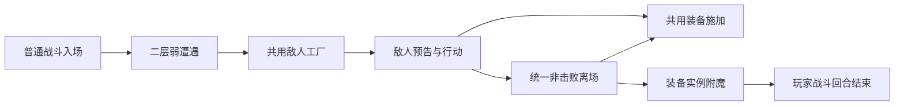
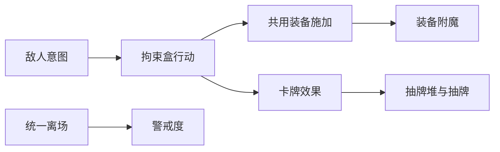
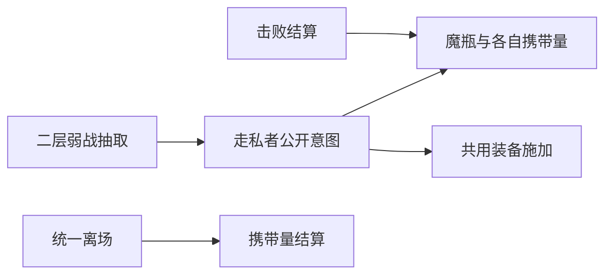
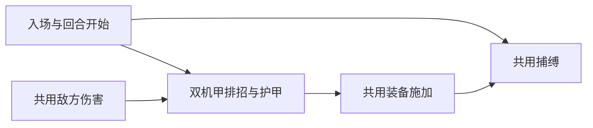

# 二层敌人

## 弱池

从出口进入第二、三幕后，各幕的前两场普通战斗等概率抽取两组不同的弱怪。第二幕有四组固定阵容：魔力强化绳索三只、拘束盒 Plus 单体、魔力走私者两只、双拘束机甲。第三幕把这四组与当前装备条件允许的所有[第一幕](enemies-first-floor.md)弱怪阵容合池，每种阵容各占一份权重。同一阵容只换站位仍算同组。精英、首领和其他房间不占这两场。练习场引用各自的固定遭遇。

## 强池

第二幕的强池共六组：拘束盒 Plus 与看着不妙的魔法阵各一只、魔力强化绳索四只、对法师特化无人机Ⅱ型单体、胶带团单体、魅魔侦探单体、无人机操作员单体。第三幕合并第一幕八组与第二幕六组，共十四组。两幕从第三场普通战斗起，在本幕剩余强怪组合中等概率抽取。抽完一轮再补满，换轮首场避开上轮最后一组。出狱重建塔路，首场普通战斗直接使用当前幕的强池。

## 跨幕生命

精英与首领沿用第一幕的地图布置和阵容。每只敌人按首次登场的幕数计算基础生命倍率，混编阵容和召唤物也各自计算。第一幕敌人在第二、三幕分别为 ×1.5、×2。第二幕敌人在第二幕取原值，第三幕为 ×1.5。浮动生命先抽基础值再乘倍率，保留小数。分裂产生的继承生命沿用分裂规则。下文数值均为第二幕敌人的基础值。

第三幕出口可继续回到第一幕，重新生成地图和遭遇。以第一轮为基准，每多完成一轮，整轮生命倍率翻倍。第一幕出身敌人在第二轮为 ×2／×3／×4，第三轮为 ×4／×6／×8。第二幕出身敌人在第二轮的第二、三幕为 ×2／×3，例如对法师特化无人机Ⅱ型为 140／210 生命。出狱返塔保留幕数与轮数。

## 魔力强化绳索

弱怪遭遇为三只，强怪遭遇为四只。每条出生独立抽取23–28整数作为基础生命。坚韧限制每段最终伤害最多8。体术、法术和固定伤害均适用，多段及群攻按各自真实命中结算。

| 行动 | 规格 |
| --- | --- |
| 凝绳缚 | 施加1件拘束值4的绳索类装备 |
| 分绳缚 | 施加3件拘束值2的绳索类装备 |
| 强化 | 提升自身两项施加行动的单件拘束值1。已达6的行动改为多施加1件。第三次强化改为准备离场，下一次实际行动执行离场 |

每条首次在三招中等概率抽选，此后在上次已执行动作之外等概率选；其他个体不影响抽选。打断保留预告与强化进度，读档恢复已抽生命与预告。普通施加允许初级至高级，无空间的次数落空。总值只是后台生成规则。

主动离场、饱和及长战兜底都尝试佩戴一件高级三档普通实体绳索，附加「收紧」。无合法新增位置时，按尚未附魔的合法普通装备的当前拘束值降序、原部位优先级选一件附魔，同级同部位沿装备顺序。闪避时本次离场照常，附魔落空。击败不触发离场附魔。

路由见 `data/tower.gd::available_weak_groups`，行动见 `core/reinforced_rope.gd::plan`，结算见 `core/game.gd::_depart_enemy`，回归用例见 `tests/reinforced_rope_cases.gd::run`。

## 拘束盒 Plus

机械弱怪，固定 86 点生命。普通装备池为皮带、胶带、扎带和堵嘴装备。性玩具走独立初级池。

| 行动 | 效果 |
| --- | --- |
| 喘息咒印 | 开场施加法术诅咒。本战每次主动打出一张魔法牌，在抽牌堆随机位置插入一张扰乱。施法失败计入，基础法术与复演各自沿原规则结算。 |
| 贴身双缚 | 施加两件普通拘束具，每件拘束值 4。 |
| 兴致升温 | 接下来三个战斗回合施加的普通装备统一为拘束值 5。 |
| 嘴腿都照顾 | 依次施加普通拘束具（优先嘴部）、性玩具、腿部拘束具。性玩具没有合法位置时改施加一件普通拘束具；被闪避时该次落空。两件普通装备基础拘束值均为 4。 |
| 绑紧别乱动 | 施加一件三档普通拘束具并附加「坚韧」。常态初级，升温时中级。 |
| 吹哨告状 | 饱和及长战斗时存活撤离并提高警戒度 1 级，上限 5。被击败时取消。 |

开场后先执行一次贴身双缚和兴致升温，再按嘴腿都照顾、绑紧别乱动、贴身双缚循环。升温到期时插入兴致升温，之后接回原循环。打断延后当前意图，三个回合按实际战斗回合计算。

「扰乱」的抽牌效果见[状态牌](cards.md)。它随抽牌与弃牌循环，战斗结束时连同法术诅咒清除。

排招见 `core/binding_box_plus.gd::plan`，结算见 `core/binding_box_plus.gd::execute`，回归用例见 `tests/binding_box_plus_cases.gd::run`。

## 魔力走私者

人形双人组合，每只固定55生命。「顺手摸瓶」从玩家魔瓶偷取最多10魔力，并尝试施加一件拘束值4的普通拘束具。偷取量为0时尝试施加两件。皮革、绳索、扎带、胶带走共用新增与替换规则。没有合法施加方案时，剩余次数改为加固池内装备。闪避逐件结算，打断保留整个招式。

第一只执行三次摸瓶，第二只执行四次，之后各自执行「找好退路」和「带货溜走」。装备饱和或触发长战斗兜底时采用共用人形逮捕规则。头顶的魔瓶图标显示各自持有的魔力，撤离预告显示将带走的量。击败时立即退还该只持有的魔力，撤离时该份魔力随走私者带走。

排招与携带量见 `core/mana_smuggler.gd::plan` 和 `core/mana_smuggler.gd::execute`，魔瓶共用 `core/mana_flask.gd::change`。

## 双拘束机甲

固定机械弱战。微型拘束机甲有 32 点生命，入场说「小身材,大拳头！」；辅助拘束机甲有 30 点生命，入场立即施加 40 捕缚。

| 机甲 | 行动 | 结算 |
| --- | --- | --- |
| 微型 | 奇数回合「拳头上膛」 | 回合开始获得 10 点护甲和当回合魔法免疫，准备施加两件带「坚韧」的皮革拘束具，单件初始拘束值为 3。出手前破甲时改为眩晕。 |
| 微型 | 偶数回合「回转蓄势」 | 准备一回合。 |
| 辅助 | 循环第 1 步 | 无行动。 |
| 辅助 | 循环第 2 步「再加一件」 | 获得 10 点护甲，玩家下次成功受到普通拘束时，该批多尝试施加 1 件同规格装备。整批闪避时保留。 |
| 辅助 | 循环第 3 步「玩具投送」 | 获得 6 点护甲，尝试施加 1 件中级 2 档性玩具，对应后台拘束值 4。 |

魔法免疫使魔法伤害归零。其他伤害先结算机械减伤，再扣护甲和生命。微型机甲每个战斗回合重置护甲，辅助机甲的护甲保留至下次敌方行动开始。

战斗中，银色半透明护甲从敌人血条左端覆盖，宽度占比为当前护甲除以当前生命，最多铺满整条。血条右侧的银盾显示实际护甲，点击可查看详情。开场台词气泡贴近说话的微型机甲，辅助机甲成功施加捕缚时，从它的位置向玩家播放束环收拢动画。

辅助机甲的捕缚在场时，微型机甲每次行动成功穿戴至少 1 件装备，捕缚＋20，每次行动只计一次。第 2 回合起每个战斗回合开始将微型机甲的单件拘束值累计＋1。捕缚失效时暂停增长，已增长的值保留。超过 6 后改为施加同样数量的镣铐。镣铐沿用原部位与上锁规则。普通装备的「坚韧」见[装备规则](equipment-design.md)。

捕缚失效时，辅助机甲下一次行动改为重挂 40 捕缚，原循环顺延。入场或重挂时，按拘束值 3 的口球规格尝试加固已佩戴的口球，空嘴时跳过。捕缚达到 100 走共用收押流程。

排招见 `core/restraint_mechs.gd::plan`，护甲与免疫见 `core/game.gd::_absorb_enemy_hit`，后续施加复用 `core/equipment_application.gd::execute`，补挂与收押沿 `core/capture_bind.gd::required_intent`。

## 对法师特化无人机Ⅱ型

二层强怪，单体机械，固定 70 生命。普通装备池为皮带、细皮带、皮革眼罩和口球。练习场使用相同遭遇。

| 行动顺序 | 结算 |
| --- | --- |
| 首回合「封口捕缚」 | 建立初始 40 捕缚，强制将口部装备替换为中级、紧度 3、上锁的假阳具口球，并获得「魔力监听」。所有随捕缚建立而施加的装备免计捕缚进度，之后解除也免计。 |
| 第二回合「皮带连射」 | 施加一件中级、紧度 2 的皮革拘束具。 |
| 第三回合「无力化」 | 施加 2 层虚弱，并随机选一件装备收紧一档、上锁。监听可以增加目标件数，同一件只选一次，目标不足即停。选到已满档的未锁目标时上锁，选到已锁的低档目标时收紧。 |

开场后交替使用皮带连射和无力化。虚弱每个玩家回合结束减少一层，生效期间体术与挣扎伤害均降低 25%，滑脱按原倍率结算。

捕缚生效时，每主动打出一张魔法牌进度增加 2，0 费或施法失败均计入。每累计两张立即追加一批基础件数为 1、单件后台拘束值为 4 的皮革装备。每件成功佩戴的拘束具按戴上时的拘束值增加进度，挣脱时扣回该件最初计入的值。开场前的装备没有这笔记录。捕缚降至 0 时解除，达到 100 时进入共用收押流程。

「魔力监听」按自身魔力余额实际升降的次数累积。每两次使下一批皮带连射、捕缚追加或无力化多处理一件。该次用掉全部件数加成，余下的一次变动跨行动保留。魔瓶和临时魔力余额的单独变化不计。意图图标显示本批件数，状态详情显示下一批加成与监听余数。捕缚解除后监听仍然有效。

排招与计数见 `core/anti_mage_drone.gd::plan`，个人魔力写入见 `core/game.gd::set_own_mana`，开场替换见 `core/equipment_replacement.gd::force_mouth_gag`。回归入口为 `tests/anti_mage_drone_cases.gd::run`。

## 胶带团

二层强怪，单体胶带类，固定 76 生命。装备池含身体胶带、眼部胶带和嘴部胶带。

- 三连贴一次施加三件胶带，每件后台拘束值为 4。
- 蓄胶给予玩家 2 层虚弱，并强化接下来两次三连贴，每次三件的拘束值均为 5。被打断时保留预告和强化次数。
- 两种起手等概率。蓄胶开场后接两次三连贴，三招循环。三连贴开场时先执行一次未强化的三连贴，再进入同一循环。
- 初始带柔韧 3。每段体术命中结算后，存活的胶带团获得格挡，依次获得 3、4、5 点并继续递增。已有格挡可抵消后续伤害，完全挡下的体术仍触发柔韧。胶带团自身回合开始时清空格挡，下次获得量重置为 3。

排招与受击反应见 `core/tape_mass.gd::plan` 和 `core/tape_mass.gd::after_hit`。逐段抵扣沿用 `core/game.gd::_absorb_enemy_hit`，虚弱与无人机共用 `core/card_effects.gd::add_weakness`。

## 魅魔侦探

二层单体强怪，86 生命，人形。常规拘束具池为扎带与镣铐，沿用人形怪的替换和加固规则。

| 行动 | 效果 |
| --- | --- |
| 1　逮捕 | 施加初始 40 捕缚，在手腕戴上手铐、脚踝戴上脚铐。手铐封锁当前最左手牌，脚铐封锁当前最右手牌。 |
| 2　打包～ | 施加警戒等级＋2 件扎带。若侦探戴上的手铐和脚铐均已解除，此次改为「铐紧」，重新施加各一件，每实际戴上一件增加 10 捕缚。 |
| 3　反抗禁止 | 捕缚进度增加 20；若先前已挣脱，从 20 重新建立捕缚。施加警戒等级＋1 件玩具及一件口球。手腕和脚踝均有拘束具时，追加一件驷马缚扎带。 |
| 4　禁止反抗！ | 全身仍能收紧的拘束具各收紧一档。往抽牌堆加入警戒等级＋1 张「挑弄」。这张状态牌为 1 费、消耗，抽到与打出时各增加 10 快感、额外触发一次牵扯。支付 1 能量打出时，加上能量消耗本身，共触发两次。 |

开场后循环 2 → 3 → 4。第 2、3 招施加的扎带、口球、玩具和驷马缚扎带后台拘束值均为警戒等级＋1，最低 2。镣铐使用专属规格。

只要捕缚生效，锁链就随手牌位置变化。解除侦探的手铐或脚铐立即解放对应一侧、减少 20 捕缚。只剩一张牌时，两侧任一锁链都能封锁它。其余新戴上的普通拘束具按实际拘束值增加捕缚，挣脱时扣回戴上时的值；玩具不参与此计数。

排招与镣铐身份见 `core/succubus_detective.gd::plan` 和 `core/succubus_detective.gd::fitted_cuff`。捕缚通过 `core/capture_bind.gd::installed` 登记，出牌和锁链显示共用 `core/succubus_detective.gd::chained`。

## 无人机操作员

二层强怪，人形，108 生命。首回合「召唤无人机」部署一台 20 生命的机械类魔导无人机。无人机从下回合行动，可以直接攻击操作员，击败她即获得战斗胜利。

| 操作员行动 | 效果 |
| --- | --- |
| 道具强化 | 每层使无人机每次实际行动额外施加一件玩具，与主动胶带的拘束值相同。准备、施加捕缚也触发，打断和耗能被动不触发。 |
| 拘束强化 | 每层使主动和被动施加的胶带、主动追加的玩具的后台拘束值提高 1，单件最高 6。 |
| 防护强化 | 操作员和无人机各获得 8 护甲，分别抵扣所受伤害，保留至操作员下一次行动开始。 |
| 维修精进 | 无人机被击毁时替换下一次强化，召唤一台满血无人机。每次维修使之后每批胶带永久多一件。道具、拘束强化层数全部继承。 |

召唤后，三种强化每组三次随机排列，每种恰好一次。打断推迟本次行动。维修占用一次行动，原来未执行的强化保留至下一回合。

无人机首动建立 30 捕缚、固定站姿。捕缚生效时，「胶带齐射」随机施加两件后台拘束值 2 的胶带，捕缚增加 10。每累计花费 2 能量额外施加一件基础拘束值 3 的胶带、捕缚增加 10。捕缚归零后先准备一回合再重挂，达到 100 预告收押。无人机被击毁时，操作员暂存进度，站姿、移动限制与耗能效果暂停。维修后恢复原进度，耗能计数从零开始；若停机时没有捕缚，新机首动重新施加。

排招、强化和召唤归属见 `core/drone_operator.gd::execute`。耗能效果沿 `core/capture_bind.gd::energy_spent`，护甲结算沿 `core/game.gd::_absorb_enemy_hit`。
