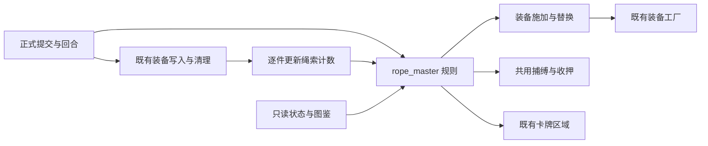

# 绳艺大师

本文件是绳艺大师遭遇的规则真源。基础生命大师140、助手36，助手在左；大师死亡直接胜利，助手退场不触发死亡效果。沿用人形替换、周目生命倍率、正式施加与捕缚收押流程。

## 行动与资源

- 大师绳索库存开场48/24，允许超额；成功新增或替换扣整件品质＋紧度，升级既有驷马缚只扣增加值，收紧不扣，失败不扣，解除不返还。助手没有库存。
- 普通绳无法施加时尝试收紧现有绳索。库存不足原规格时，随机绳池先降品质再降紧度；指定装备（含同款股绳的不同品质）按[固定类型削减规则](equipment-design.md#140-后台拘束值)处理。削减后立即预约补绳。库存不足两点或不足以施加待处理的驷马缚时，先补绳。有助手补至至少当前上限，无助手增加当前上限的一半，均不截断超额；助手的公开意图同步改为帮忙。
- 开场：隆重介绍（召唤助手）→领域展开（建立捕缚，手腕／手肘下方各中级二档，受占用则等值改投其他位置）→看我手速（可佩戴绳索的空身体部位各中级一档，股绳一件）→收紧→收紧→补绳。
- 循环：编织绳网（初始两件值3普通绳）→绳索附魔→全部绳索收紧1档→欣赏作品并指指点点（全部敏感部位除马眼，各基础3，整体结算；额外使绳索上限＋4，后续编织绳网的值3普通绳数量＋1，可叠加）。成长仅提高上限，不即时增加库存；第三轮末第四招替换为永久封缚，本次不触发欣赏作品的成长：本场全部绳索最低一档，任何方式均不能解除；之后第四招恢复欣赏作品。
- 绳索附魔优先选择未拥有种类，全部拥有后随机叠加：力量／灵巧各－1；玩家回合结束自身魔力－5；每次打牌基础快感＋1。捕缚值0时暂停，不删除层数。
- 行动优先级：战斗结束、收押、补绳、悲伤、复活、原行动。复活行动显示为「回来吧我亲爱的手」。插入行动与被打断不推进原开场／循环步骤。

## 捕缚与驷马缚

- 捕缚不可直接攻击或清除，值取全身有效绳索的品质＋当前紧度，物理实例计一次，含原有绳索、股绳、驷马缚，上限100。进度可降为0而来源保留，100沿现有收押时机执行。
- 首次向上跨50、75及每次重新向上跨90，各增加醉绳2层；同次跨越各阈值只结算一次。首次跨50施加中级二档驷马缚，每次跨80施加／升级为高级二档，不降已有品质。库存不足时保留最高待施加规格，插入补绳后立即补做。阈值附加装备引起的后续跨越继续结算，不重复同一次跨越。
- 驷马缚沿用普通绳耐久与减伤，只有一个物理实例，视为手腕和脚踝同时拘束，不占普通容量。自身不能作为任何链接绳的端点，也不产生连接式或一体式躯干固缚，包含紧度三档的手腕固定绳。可挣扎、切割、直接解除，不可普通／魔法滑脱。佩戴时强制躺姿、后手，禁止移动、站起与体术。重复施加恢复对应二档耐久；已有普通装备保留。
- 永久封缚禁止耐久归零、直接解除与替换移除绳索；战斗结束解除限制，已有装备保留。
- 手腕与脚踝展示同一驷马缚实例，共用耐久与紧度；从任一部位造成伤害或降低紧度都会同步，两处在整件解除时同时移除。
- 驷马躺姿由身上仍有效的驷马绳决定，离开大师战斗后继续生效。道具可以从背包加入手牌，解开后才能打出。牢房内的移动、踢通风口、用钥匙和通过出口都需要先解开绳子。
- 驷马期间收起肘击、近身短打、所有踢击及小魔女的魔女飞踹。无尽魔法少女战神生效时，这些基础攻击可以照常切换与发动，角色保持驷马躺姿。鲤鱼打挺与心理暗示单独生效时仍受驷马限制；鲤鱼打挺自由面可提前预备，实际用出腿部体术时触发。火球术和小魔女的施法预备按各自条件使用。
- 整备或火堆还有回合时照常行动。回合耗尽后，只能用手牌的拘束面挣扎驷马绳。手腕、脚踝共用原绳耐久，照常支付费用并结算伤害，多段攻击在绳断时停止。手里没有可用挣扎牌时可以正常结束回合，从自己的牌堆抽下一手并补满能量。额外回合保留回合计数、魔力和魔瓶储量。绳断后立刻接续原流程。在塔路或途中挣脱时，保留路线及移动进度。
- 捕缚的清除免疫只作用于战斗内解除效果；正式收押或战斗结束时，沿通用清理流程清除捕缚记录。

## 助手

- 召唤当回合不行动，随后三个战斗回合不可单体选中，群攻可以命中，随机单体目标也不得选择；复活重新获得保护。
- 行动：准备状态牌→向抽牌堆加入一张强人锁女并施加／替换高级二档口球→空部位初级一档绳索→建立卡牌触发效果；此后每次行动只结算一次指定部位基础6快感，不叠加持续效果。
- 强人锁女不可打出，抽到时不可反抗＋1。助手死亡移除其所有状态牌和不可反抗，移除卡牌触发效果；复活从第一招开始。
- 不可反抗令下一张装备伤害牌全部装备伤害为0；醉绳只归零绳索伤害。同牌多段、群体、复放共用一次拦截；两者均适用时只扣不可反抗。支付、抽牌等其他效果保留，施法失败不消耗，纯降紧／解锁／直接解除不消耗。
- 不可反抗、醉绳及三种绳索附魔显示在玩家左侧状态栏，角标为当前层数；耗尽或来源清除后移除，离开战斗后停止显示。悬停与点击沿用状态详情入口。
- 卡牌触发效果在成功施放并作用于装备时每张牌结算一次，即使伤害被上述状态归零仍触发。按部位可用性选择原方案或备用方案；杯类、平板锁及无对应身体部位均走备用方案。所有部位数字为基础值，整体结算一次。
- 高潮预约下一回合休息，多次只预约一次；大师补绳时助手帮忙不行动，两种暂停均不推进步骤。
- 每次实际击败助手触发死亡追加：两件拘束值4特殊装备，沿人形替换规则，无合法位置落空。大师预约悲伤；第一次悲伤后预约复活满血助手，第二次悲伤后不再复活。补绳、收押按上文优先级插入，保留待执行的悲伤／复活。

## 实现边界

新增遭遇状态集中保存在大师及助手实例，随新战斗初始化并随快照保存；装备计数按物理实例增量更新，不在玩家每次提交时重新扫描全身装备。欣赏次数由 `rope_art.admired` 保存，缺省为0；上限与编织数量由这一个计数派生，旧档不新增迁移。敌人模块不新增玩家指令。规则验证入口为 `spire-godot/tests/rope_master_cases.gd::run`；成长、补绳优先级与存档覆盖见 `spire-godot/tests/rope_master_cases.gd::growth_and_refill`。
