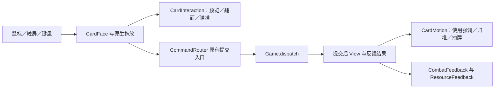
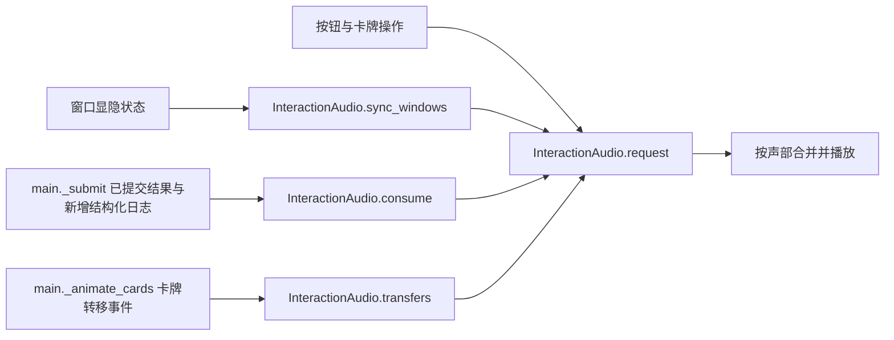

# 响应管线（输入 → 提交 → 落地）

契约文件：冻结一次玩家输入从进来到界面落地这条链上的两个接缝——**接缝 A（UI↔core，既有接口）**
与**接缝 B（UI 内部的提交与落地）**。内部实现以代码为准，接口语义以本文件为准。
函数名与稳定 ID 是锚点；本文件不写行号，也不写执行结果：通过／失败／未执行与红集一律登记
`docs/record/verification.md`。

实现状态：现行 UI 入口是 `_submit`、`present` 与 `render`。提交前后均为战斗时，`_submit` 比较既有节键，
非空局部脏集交给 `present(dirty, updated)`；空集、战斗外及进出战斗交给 `render(updated)`。
`present` 已支持多节局部刷新及各节既有全量兜底。

路径约定：不带 `spire-godot/` 前缀的源码、测试与工具路径（`core/`、`ui/`、`data/`、`tests/`、
`tools/`、`build/`）均相对 `spire-godot/`；`docs/` 相对仓库根。

## 域

- 一次玩家输入的全部去向：选择类点击（只改本地选中态）、提交类点击（进唯一提交入口）、
  被拒／无效分支（只呈现原因）、以及提交成功后的投影与界面落地。
- 文件域：`ui/main.gd`（唯一允许 `preload` core 的 UI 文件；唯一提交入口与全部节重建函数）、
  `ui/keyboard_input.gd`、`ui/touch_input.gd`、`ui/first_turn_presenter.gd`、`ui/target_queries.gd`、
  `ui/shell/game_layout.gd`、`ui/shell/body_sidebar.gd`、`ui/shell/header.gd`，
  反馈模块 `card_motion.gd`／`resource_feedback.gd`／`combat_feedback.gd`／`enemy_feedback.gd`／`battle_feed.gd`／
  `impact_feedback.gd`／`equipment_audio.gd`／`hero_voice.gd`、`ui/card_interaction.gd`；
  core 侧被消费的只有 `core/game.gd` 的 `dispatch`／`get_view`／`number`／`restore_snapshot`／
  `restart_snapshot`／`Prison.*`、只读文案 `ActionCopy.result` 与 `core/game_view.gd` 的 `View.build`。
- 卡牌表现模块 `ui/card_interaction.gd` 消费卡面与原生拖放显示事实，不写规则、不新增规则接口；手势与失效条件见 `docs/design/input-controls.md`。
- 依赖方向（不得新增反向边）：`core`／`data` 不 preload ui；UI 不读 `game.state`、不调用 `dispatch` 之外的
  规则写入口（快照入口 `restore_snapshot`／`restart_snapshot` 只允许在 `_resume_snapshot`、`restart`、
  `_quick_sl` 三处使用）；`ui/target_queries.gd` 不持有 Game、控件或跨刷新缓存；
  `ui/command_router.gd`／`ui/command_routes.gd` 不 preload core。

## 接口

### 接缝 A：既有接口（语义冻结，不改）

| 接口 | 输入／返回 | 谁能调 | 信任依据 |
| --- | --- | --- | --- |
| `game.dispatch(cmd, expected_version) -> Dictionary` | `cmd`＝类型化指令 `{kind, params, expected_version}`（kind 与键面见 `docs/spec/candidate-removal.md`；`params` 只用稳定 ID）。成功 `{ok:true, version, resource_feedback, card_feedback, music_feedback, sound_feedback, checkpoint, spell_failed, fact, phase, overloaded}`：`fact` 为本次提交的判定行（display fact；`ui/main.gd::_submit` 由它取呈现用的 `payload`，不再于提交前另查 `command_fact`；一次成功提交只在 `dispatch` 内做一次事实出口查询）；`phase`＝提交后（已提交态）的相位，`overloaded`＝提交后的过载态（归一化段 `ui/main.gd::_submit` 的 `_close_drawers()` 判断依据），两键都是**提交后状态的只读标量**，与 `core/game_view.gd::build` 的 `phase`／`pressure.overloaded` **同源同值**（过载态的唯一定义处＝`core/pressure.gd::overloaded`，`Pressure.view` 与 `dispatch` 共用它），不构成第二份判定／第二份相位真源，**不得由 `payload.kind` 反推**；失败 `{ok:false, error:String, fact:{}}`（不带其它键；两键只在 `ok==true` 时出现） | 只有 M2 `_submit`（测试可直调，UI 其它文件禁止） | 只有 `ok=true` 才写状态：`state=state.duplicate(true)` 后执行事务，失败回滚，不留部分付款／部分装备；core 侧拒绝语义与 `tests/test_game.gd` 的 TC-CORE-0002／0003 锁定 |
| `game.command_params(kind, source)`／`game.command(source)` | 指令装配的唯一投影／唯一装箱 | UI 指令层（`ui/command_router.gd`／`ui/command_routes.gd`）与测试；不得在别处二次装配 | 同一形状 → 同一 `params` 只有一条路径；键面＝`core/game.gd::COMMAND_KEYS` 的 39 kind 声明（`tests/architecture_cases.gd::command_params_keys_pinned`） |
| `game.command_issue(cmd)`／`game.command_fact(cmd)` | 形状与参数合法性复核（失败返回「该行动已经失效，请重新选择。」）／形状 → 当前状态下的显示事实 | `command_issue` 由 `dispatch` 内调用；`command_fact` 供提交复核、显示读取路径与测试 | 形状与 `params` 相等的事实恰有一条；不写 `valid`／`reason`、不产事件、不推进随机、不跨调用保留 |
| `game.get_view(demand := [])` | 输入＝**需求**（一组组名；缺省 `[]` ＝全组，与显式全组是**同一语义、同一条路径**——需求闭包的唯一实现＝`core/game.gd::fact_demand_groups`，组→单元在 `core/command_registry.gd::FACT_UNITS` 的组列，投影承接组下限＝同文件 `VIEW_FACT_GROUPS`）；纯只读投影（`View.build` 内调 `Game.command_facts()` 取显示事实、每条显示事实的 `ReleaseView.preview`、显示集合 `card_texts`、room_event／shop／relics／prison 四个 view）；唯一新增 View 键 `display_fact_scope`＝本次实际投影的组集合（＝`display_facts` 各行 `group` 的去重排序，可推导）。需求只决定**哪些单元被构建与哪些行外放**：`display_facts` 恒为全组行的**纯子序列**（逐行逐字节、顺序一致、无增无减），其余 View 键的取值由闭包下限保证与全组构建逐字节相等（判据 `tests/architecture_cases.gd::default_projection_is_unchanged`／`lazy_projection_invariant`／`fact_groups_are_total`／`whole_table_branches_force_full_demand`；接管／`card_chain`／`pending_retain` 三支按声明守卫取全组） | 唯一允许的调用点集合：`_resume_snapshot`、`render`（空快照）、`_submit`、`restart`（`tests/architecture_cases.gd::get_view_call_sites_are_pinned`）；`_submit` 的局部重建分支（前后均 battle 且节键可用）传**声明需求**＝`ui/main.gd::_present_demand`（`PRESENT_DEMAND`／`PHASE_OPEN_DEMAND` 两张字面表＋与归一化段共用的开合实现 `_submit_opens`；失败提交退化为 `PHASE_OPEN_DEMAND` 兜底），其余调用点与 `render(updated)` 回落取缺省＝全组（判据 `tests/architecture_cases.gd::submit_demand_call_sites_are_pinned`／`demand_declarations_are_total`／`section_read_sets_are_pinned`；实际读取记录器为 `tests/display_ui_cases.gd::present_demand_recorder`；逐节读集与需求声明对照 `docs/spec/fact-table-dependencies.md`「需求声明」） | `view.version` 等于投影来源的已提交 `state.version`；**在不改变实际呈现效果的情况下，尽量降低单次成本**；投影结果不得当规则判定来源 |
| `restore_snapshot(saved)`／`restart_snapshot()` | 返回 `{ok,error}`／快照字典；UI 只判断 `ok`，不解析结构、不迁移字段 | 快照入口只允许 `_resume_snapshot`、`restart`、`_quick_sl` 三处 | 见 `docs/spec/save-fixed-points.md` 与 `docs/spec/transition-pipeline.md` 的冻结时机约定 |
| `game.number(n) -> String`、`game.Prison.*` 常量 | 显示格式化与立绘选择 | M3／M5 节函数 | 只读显示调用，不参与判定 |
| `TargetQueries` | static查询只吃View与载荷，无查询缓存。唯一调试例外为 `ui/target_queries.gd::debug_exchange_read_observer` 的瞬时Callable交换（返回旧观察者）；两叶结果经 `_debug_observe_read` 只在debug且已安装时通知隔离数据/函数栈，release或未装不捕栈/复制 | 各节查询；观察仅测试独占生命周期 | 返回显示事实（不复制、不改写）；`RELEASE_MODES` 是唯一模式定义处；`first_usable` 全不可用返回**首项**，末项回退由 `fallback="last"` 显式声明，两者不得按名字相近合并；原返回值/顺序不因观察改变 |

**三个按需只读入口不属于 `get_view` 白名单**：`game.live_card_text`、`game.live_card_text_set`、
`game.candidate_detail`（语义见 `docs/spec/ondemand-copy.md`）。它们不改白名单，也不得经 `get_view`
参数化实现。

**shell／输入／反馈消费方契约**（后一个 agent 据此调用，不必读内部）：

| 接口 | 输入／返回 | 谁能调 | 信任依据 |
| --- | --- | --- | --- |
| `game_layout.begin_frame(home)`／`end_frame()` | 只清临时子节点，保留 `MoonlitGallery`／`hero`／`body`／`enemies`，重置 `used`；`end_frame` 释放本次未标 used 的 body／敌人 | 只有 M3 的节／页函数 | 调用后保留实例仍有效 |
| `hero_portrait(view, fixed, rect) -> Control` | 传入 View（不是 `state`）；创建或就地更新 hero 实例并定位 | 战斗／阶段页节函数 | 返回活实例；只更新外观；`EquipmentPortrait.uses_fixed_portrait` 只读 `character_id` 与固定立绘偏好 |
| `enemy_group(enemy, settings) -> Control` | `enemy` 为 View 的敌人条目；按稳定 `id` 复用分组 | 战斗页节函数 | 同一 `id` 的实例身份保持；离场敌人由 `end_frame` 删除 |
| `body_sidebar(ui)`／`body_sidebar.configure(ui)` | 实例化／重排身体栏 | M3 身体栏节 | 返回后 `ui.body_buttons` 对当前 View 有效；键命中时按钮与滚动保留 |
| `body_sidebar._presentation_key(ui)` | 纯显示字段键（高度、locale、选中部位、展开顺序、各区域 members 显示字段） | 加固门禁与节键比对 | 只渲染事实：绝不保存旧 View／候选／装备图；新增显示字段必须同批进键 |
| `body_sidebar.expand_applied(ui, before, after)` | 两个 View；比较 `body_regions.targets` 的物理 ID 新增 | 只在提交 ok 分支且 phase 命中时 | 同件加固／降档不展开；非战斗与失败不展开；不选装备不派发 |
| `keyboard_input.handle(event) -> bool` | 返回是否已处理；内部可能调 `host._submit`／`host._activate_card` | `main._input` 与 PopupMenu 桥 | host 成员名与语义在本管线内冻结（`view`／`actions`／`card_buttons`／`card_faces`／`attack_forms`／`_submit`／`_activate_card`／`render`／`_show_term`／`_hide_term`／`_panel`／`_label`／`_button`／`_open_drawer`／`_close_drawers`／`DRAWERS`／`modal_region`／`quick_release_*`）；android 直接返回 false；不新增 `dispatch` |
| `keyboard_input.refresh_hints()` | 幂等重建按钮角标 | `render` 与 `present` 局部末尾（均 `call_deferred`） | 只读 view 与 settings；无游戏副作用 |
| `touch_input` | 把触摸合成鼠标事件推入 viewport（含 PopupMenu 独立视口桥） | 引擎输入；`_ready` 由 main 挂载 | 不直接调提交／规则；长按阈值与取消路径不提交；UI 侧不得假设存在触摸专用入口 |
| `card_interaction.inspect`／`capture_flip`／`flip`／`begin_drag`／`clear` | 既有卡面工厂与控件、当前拖放载荷；逐帧瞄准只消费 `DropTarget` 原生接受结果 | 卡面回调、`DragTargets`；提交前与重开清理 | 无规则、资格或提交写入；幽灵节点忽略鼠标；失效与手势契约见 `docs/design/input-controls.md` |
| `card_motion.positions(ui)`／`enqueue(events, before)` | 抓取当前手牌按钮位置／角度／牌面；core 的 `card_feedback` 事件＋提交前快照 | `_submit`：`positions` 在 `dispatch` 前，`enqueue` 在 ok 分支且展示更新之后 | 只读；不改状态；不推进随机；幽灵卡不持有牌、不挡输入；`pending_draws` 隐藏新抽牌按钮的规则必须被手牌节尊重 |
| `resource_feedback.enqueue(events, point, instant_fields)` | core 的 `resource_feedback` 事件＋锚点 | `_submit` ok 分支 | 只消费已提交差值；`show_home` 时自毁 |
| `combat_feedback.play(ui, before, payload)` | 提交前 View＋已提交 payload | `_submit` ok 分支 | 敌人伤害与连续解除逐击读已提交日志的 `damage`／`follow_through_hit`，装备汇总仍读耐久差分；不预测、不改伤害／意图／资源／时机 |
| `impact_feedback.play(events, payload, snapshot)` | `dispatch` 返回的 `resource_feedback` 事件（可为空数组）；本次已提交候选的载荷；提交后 View | `_submit` ok 分支（经 `ui/main.gd` 的节内助手按 `will_play` 预判后才创建节点） | 只消费已提交数据：不读 `state`／`state.logs`，不预测、不改数值／候选／存档／随机；无效果可播时空操作；层内节点 `MOUSE_FILTER_IGNORE`、无 `_process`，一次性 Tween 后 `hide()` 并 `set_process(false)`；效果族由已提交事实唯一决定（`pressure` 净涨出滤镜、`charge`／`next_energy` 净涨出黄边框、`mana`／`temporary_mana`／`witch_focus` 任一净变化出蓝边框、载荷 `kind=="calm"` 出白边框，多族命中按白＞黄＞蓝取一；攻击／挣扎／滑脱出震动）；蓝边框 gain／loss 只由净增量符号决定，强度按字段参考尺度归一化，无最小增量门槛 |
| `enemy_feedback.finish()` | 清 `ui.enemy_feedback` 并释放 | `_return_home`、`_reset_interface`、播报结束 | 节点存在即「播报期」：提交入口守卫与 `blocked()` 都据此吃输入（产品决策）；全屏 `MOUSE_FILTER_STOP` 不得被 `render` 提前回收 |

### 卡牌表现的职责与时序



- 动画不承担支付、抽牌、伤害或回合推进。`main._submit` 成功提交后，只有 `spell_failed` 产生简短失败提示；正常出牌不另弹居中的成功播报。卡牌是否留手／消耗／归堆消费原有反馈，不由动画猜测。
- 右侧即时记录由 `CombatFeedback.play` 读取提交前后 `View.logs` 的新增区间，交 `ui/battle_feed.gd` 排队；只保留有界显示节点和待播文字，不保留 View 或装备快照。`render`／`present` 通过 `CombatFeedback.sync_feed` 维护阶段可见性，既不补播历史，也不增加事实查询。普通重绘复用队列；换场、读档回退和界面重置使队列失效。敌方标题与记录的开放时机、显示上限及日志入口见 `docs/spec/release-interface.md`「行动日志」。
- 能量、本体魔力、临时魔力与魔瓶的文字值显示提交后的真实余额；资源条可继续插值、浮字可依次播放，但不回放旧数字余额。
- 回合信息保留在原状态栏，不另加回合横幅；沿用现有抽牌依次到手的演出，不增加输入锁。手牌顺序保持规则给定顺序，不因查看／拖动而排序；拖动期间只隐藏原卡的显示，原控件及正式落点判定保持，取消或拒绝统一恢复。
- `DragTargets.begin` 对已有合法、无需再选具体目标的自身卡创建透明战场接收区；仍由 `DragTargets.receiver` 校验载荷／版本并向原指令路由提交一次。无效牌、具体装备／敌人／手牌目标不启用该区；人物立绘与资源显示保留，不加人物目标高亮框或额外按钮。
- “减弱卡牌动效”跳过翻面幽灵与卡牌转移动画，停止瞄准光圈脉动和手牌下沉；保留目标识别、结果提示与原本的操作条件。
- 新显示节点不阻断输入，不创造过肩立绘、镜头视差或新的战斗机制。核对入口为 `tests/card_interaction_ui_cases.gd`、`tests/touch_ui_cases.gd`，并复用 rewards／keyboard／targeting／interface 的交互检查。

### 现行自动接管与提交守卫

- 首回合规则由 `core/first_turn_control.gd` 从已有正式候选中选出下一步，经 `GameView` 输出
  `view.first_turn_control`（`name`／`locked`／`candidate`／`key`）；具体玩法见 `docs/design/game-design.md`。
  展示层不能重选动作、重算资格或推进规则随机；`control_next` 由 core 在事务内消费，UI 经指令路由原样提交该条指令（含 `expected_version`）。
- `_submit(cmd, takeover=false)` 是唯一提交入口（指令路由的执行段）。普通输入在接管锁定时返回；
  `takeover=true` 仅供 `FirstTurnPresenter` 的已选步骤进入该入口，仍受首页／敌方播报守卫、
  指令形状＋参数合法性＋唯一判定与版本复核约束——此参数不是跳过规则验证的权限。
  成功和失败均刷新投影；自动提交结果另交 `outcome` 播放反馈。
- 接管展示跨等待保留候选及版本，以游戏对象身份、`generation`、版本、首页状态与接管锁定状态共同失效；
  改局、返回首页或版本变化后，旧步骤不得提交；节点使用前重新检查有效性。
- 证据复用 `first_turn_control_cases`／`first_turn_control_ui_cases` 的真实接管、手动输入阻断与换局取消；
  `tests/architecture_cases.gd::projection_contract` 覆盖自动接管、手动零能量首回合与双面能力开关的
  状态／注册表引用隔离。

### 接缝 B：既有 `present` 与 `render`

```gdscript
func present(dirty: Array = ["*"], snapshot: Dictionary = {}) -> void
func render(snapshot: Dictionary = {}) -> void
```

- `present`：按 `PRESENT_SECTIONS` 顺序各处理一次 `dirty` 内的局部节；完整全量判断只经 `ui/main.gd::_present_needs_full_render(dirty,source)`（source缺省为当前View），包含空集、`*`／`page`／未知节与所有既有结构/节状态条件。不以脏集多于一节作为全量条件。提交路径初投仅供节键求值，归一化与dirty后由同一谓词决定回落；初投裁剪且需全帧时在 `_submit` 的既有第二回取口取全组，最终 `render` 不吃裁剪快照。独立 `present` 回落仍使用当前或传入View，不新增自身 `get_view`。
  `snapshot` 非空则原子替换 `view`；为空则用当前 `ui.view`；两条路径均不额外 `get_view`。
  `render(snapshot)` 保留「空 snapshot 才 `get_view`」的语义。
- 局部路径不 `begin_frame`、不清空 `layout.used`，固定顺序为：
  `DragTargets.clear(self,false)` → `_hide_term`（仅 notice 单节跳过）→ View 同步 → 节键比对 → 重建脏节 →
  `_sync_drag_versions`（保活拖放源的载荷版本追平当前 View）→ `layout.end_frame()` →
  `keyboard_input.refresh_hints`（`call_deferred`）→ `_localize_controls`。

### 既有节键表（节名同时是 `dirty` 元素）

键只用「当次 View 投影 ＋ 本地 UI 态」的纯数据副本（Array／Dictionary／基础类型）；
**`version` 不进键**；键必须覆盖该节渲染实际读取的 View 字段（新增 `view.<field>` 读取必须同批进键）。

`PRESENT_SECTIONS` 声明顺序，`ui/main.gd::_submit_presentation_keys` 只聚合下列既有键，不复制字段集。
表中没有文件前缀的函数位于 `ui/main.gd`。

| 节 | `present` 的局部入口 | 键真源 |
| --- | --- | --- |
| `header` | `header.configure` | `ui/shell/header.gd::_presentation_key` |
| `relics` | `_relic_row` | `_relic_presentation_key`（行面＋按 relic id 的 `relic` 组候选读——节键覆盖本节重建读取的组，无已声明例外；判据 `tests/architecture_cases.gd::section_read_sets_are_pinned`） |
| `hand` | `_hand`（先 `_sync_card_faces` 把本次抽牌的面同步进 `card_faces`，再按**固定顺序**：拦截（`_hand_presentation_key` ＋ `_hand_key_hit`／`_hand_row_plan` 的纯数据 diff）→ 逐卡值更新（`_hand_apply_card`）→ 成员增删（`_hand_release_card` 先、`_hand_mount_card` 后；行态同此步经 `_hand_reset_row`）→ 幂等重排（`_hand_place_row`，几何/顺序未变则连它都不调用）） | `_hand_presentation_key`：`[locale, 行态, 顺序(uid), pending(uid), {uid: 每卡窄键}]`；每卡窄键（`_hand_card_key`）只由该卡自身的透传字段、`availability`、面状态、选择态与 pending 组成，不整行深拷贝、不含 `view.card_costs` 等 View 级切片；`version` 不进键 |
| `actions` | `_build_action_rail` | `_action_presentation_key` |
| `posture` | `_refresh_posture_section` | `_posture_presentation_key` |
| `resources` | `_refresh_resource_section`（另经 `_sync_hero_stage_meters` 维护英雄舞台快感／魔力／捕缚米表、捕缚拖放接收器与施法标签偏移） | `_resource_presentation_key`（含 `view.casting.percent`） |
| `show_log`（共享抽屉） | `_refresh_log_section` | `_log_presentation_key`；只读约定见 [界面契约](release-interface.md#行动日志) |
| `body_bar` | `layout.body_sidebar` | `ui/shell/body_sidebar.gd::_presentation_key` |
| `body_details` | `_refresh_body_details_section` | `_body_details_presentation_key` |
| `pickers` | `_refresh_picker_section` | `_picker_presentation_key` |
| `speech` | `_refresh_speech_section` | `_speech_presentation_key` |
| `notice` | `_refresh_notice_section` | `_notice_presentation_key` |
| `drawers` | `_refresh_drawer_section`（按当前打开的抽屉重建） | `_drawer_presentation_key`（菜单面＋道具抽屉内容）；只读约定见 [界面契约](release-interface.md#行动日志) |
| `page` | 无，始终全量 `render` | 无局部键，不进入提交脏集 |
| `scene_instances` | `_refresh_scene_instances_section`（另经 `_enemy_row`＋`_place_enemy_row` 维护存活敌人的展示顺序与整行几何） | 无统一节键；外观由既有 arena／`equipment_portrait` 叶实例比对；状态图标条由 `_status_strip` 按 owner 键（`_status_keys`）比对；存活敌人的名条／血条／HP 文本／意图图标由 `_sync_enemy_stage` 按名复用并原地更新，图标另按 `_intent_icon_keys` 增删，按钮另按 `_enemy_select_keys`；`gone` 敌人的整槽由 `_release_enemy_stage` 释放 |

基础攻击事实的 `posture_available` 由 `core/game.gd::_attack_offer_fact` 复用实际姿势判定产出，基础踢击沿用 `core/game.gd::kick_profile`；无视姿势效果仍经 `data/basic_attacks.gd::posture` 解析。`ui/main.gd::_build_action_rail` 只按该字段筛选显示与形态切换，不删除正式指令事实。字段进入 `_action_fact_slice`，随姿势或相关能力变化使行动栏缓存失效；其余禁用条件不影响形态是否显示。

节键计算的成本同样要进测量（见「证据入口」），不得默认「算键几乎免费」。
`hand` 的每卡窄键（`ui/main.gd::_hand_card_key`）逐档（0／12／26／44 件）不得随装备件数增长：
它只读该卡自身的透传字段与本地显示态，不读候选／身体／装备候选切片（反面证据：抽屉键曾随件数线性）。

### 缓存与失效键

允许（只读显示口径）：core 只读调用内的装备显示行复用与 `face_texts` 合批；
`body_sidebar._slots_key`／`_button_index`（显示字段键＋稳定部位 ID → 按钮索引）；
`card_faces`／`card_draw_serials`（本地翻面／抽牌显示态）、`map_drawings`（界面备注，随本局保存）；
`ui/main.gd::_hand_cards`（每卡缓存：`button_id` ＋ 每卡窄键 ＋ 合并数据 ＋ 每面**已应用值切片** ＋ 已应用面）。失效规则（逐条可证）：
①每卡窄键的**数据部分**变（透传字段／`availability`／选择态／pending／locale）⇒ 该 uid 两面切片作废，下次应用重建；
②面选择位变（翻面）不作废切片：已缓存的另一面切片被原样交给 `ui/main.gd::_refresh_card_face` 重写同一批节点（每个 (card, side) 切片至多构造一次）；
③画风变（`display_settings.art_changed`）不作废切片，纹理经 `ui/card_face.gd::_apply_art_texture` 每次现取；
④按钮实例变（`button_id` 不符）或 uid 离行 ⇒ 条目丢弃（`_hand_release_card` 删，`button_id` 守卫兜底）；
⑤全量 `render` 后成员必为新 ⇒ 条目经 ④ 失效，由该次 `_hand` 重建；
节键本身（当次 View 投影＋本地 UI 态的纯数据副本）。

禁止：用 `version` 当键或当缓存版本号（`version` 不单调，`restore_snapshot` 后可回退，进键会误命中）；
用译文、颜色、名称、图片识别玩法对象；把投影结果当规则判定来源（UI 不得自行推断资格或作废范围）。

准入线：**复用必须附可证失效规则；无证明即禁止。** 跨操作持有投影（`ui.view`／`ui.actions`）与
自己的显示态允许。

## 输入域

- `_submit` 的脏集唯一来源是 `_submit_presentation_keys` 提交前后读取的既有键；不按指令 `kind` 维护脏表。
  缺 `GameHeader`、layout 无效或 View 为空时不算键，直接全量；只有前后均为 battle 才使用局部候选。
- 成功战斗提交额外加入 `scene_instances`；失败不因它无统一节键而加入。
  过滤只按提交前既有谓词去掉已未挂载的 `show_log`／`pickers`／`body_details`／`drawers`；
  `speech` 不进这条过滤。空 `notice` 仍从候选去掉，清空靠多节路径前缀 `_hide_term`。其余结构性全量条件保留。
- `dispatch`：`cmd` 是**类型化指令**（`kind`＋`params`，只用稳定 ID，不含候选提交身份 id）；
  形状与键面由 core 的声明表复核，形状无对应行动只会被 core 拒绝，不得由 UI 预判；
  `expected_version` 为 UI 当前 `view.version`，调用方传 `-1` 时由 UI 补。
- `get_view`：输入为组需求，缺省为空即全组；调用点必须落在唯一集合内（`_resume_snapshot`／`render` 空快照／`_submit`／`restart`），各点的需求分支见接缝 A。
- `impact_feedback.play`：`events` 只接受 `dispatch` 返回值的 `resource_feedback` 数组；`payload` 只接受本次已提交
  候选的载荷（普攻读扁平 `damage`，伤害卡读 `preview.damage` 与 `mode`）；`snapshot` 只接受提交后 View。
  三条输入都不是资格判定来源：与当前 View 不一致时按「照实表现已提交结果」处理，不做规则推演、不重算、不拒绝。
- 选择类点击（`_activate_card`、`_card_target`、`_select_enemy`、`_player_picker`、
  `_hand_target_picker`、`body_sidebar._toggle`、`keyboard_input` 的 `select_card`／`cancel`、`quick_release_bar.select`）：
  只改本地选中态，不 `dispatch`／`get_view`／`save`。
- 提交类点击（状态控件、行动格、姿态控制、底栏、墙面控制、装备格、行动行、卡牌目标、监狱控件、
  紧凑行动、路线屏、拖放接收器、键盘）最终都进同一提交入口，不得各自实现提交或保存。

## 失败语义

- 现行 `_submit`：主页或敌人播报中直接返回；其余提交在 `dispatch` 后无论成功或被拒都会重新 `get_view`，
  设置 `notice` 并调用 `present(dirty, updated)` 或 `render(updated)` 同步 View。只有成功提交才进入反馈分支，
  只有成功结果的 `checkpoint` 非空才自动写盘。选择类拒绝继续沿各自既有提示入口。
- `dispatch` 拒绝语义（core 侧，UI 不得改写文案）：五预检分列版本比对两侧——
  `Consumables.validate_buffs`、`Binding.state_issue` 在版本比对**之前**，
  `SpecialEquipment.validate`、`Cards.validate`、`RelicEffects.validate` 在**之后**，各自返回自己的 `error`；
  版本不符 → `"状态已更新，请重新选择行动。"`；指令形状或键面不合法，或形状在当前状态没有对应行动 →
  `"该行动已经失效，请重新选择。"`；形状合法但判定不通过（`valid=false`）→ 判定的 `reason` 原文。
  UI 义务：不自行判定资格、不改牌面、不按名称／颜色／译文识别对象、不重试、不改派候选。
- 锁定断言（不得删、不得放松）：`tests/ui_smoke.gd` 的 `_index_boundary_tests` 四条——
  失败提交后状态不变且 `notice` 非空；`view.version==state.version` 且 `view.energy==state.energy`
  （显示快照被刷新）；旧版本拖放被拒；`ui.actions` 已按新状态重建。
- 禁止：版本不等时跳过重同步或跳过 `actions` 替换；任一情形吞掉 `notice`；自动重试；删掉上述断言；
  以「应该更快」或单次采样宣称提速。
- 成功路径不得因未来刷新重构改变：自动保存仍只在 `ok` 且 `checkpoint` 非空时；`expand_applied` 的 phase 条件不变；
  提交路径的 `_reset_interface` 仍只在 `demo_continue` 调用；反馈仍在展示更新后、只在 `ok` 分支。

## 交互音效

`sound_feedback` 的即时标识保持字符串；敌方材质音效另携带 `{cue, enemy_id, sequence, kind}`，与既有敌方动作展示同步，详见 `docs/spec/release-interface.md`“装备材质音效”。

`spire-godot/ui/interaction_audio.gd` 是本组音效的唯一播放入口；素材位于 `spire-godot/assets/audio/interaction/`。



- 控件加入场景时接线；同一帧内按控制、行动、抽弃牌三个声部各取一个声音。窗口开合替代同次普通点击，火球术替代同次通用施法成功与命中声。抽弃牌声部额外降低 7 dB；保留素材本身的窗口低音量。
- 成功／失败施法读取新增日志的 `spell`，命中读取 `enemy`＋`damage`，抵消读取 `evasion`；只消费提交前后新增的日志区间，既不读取显示文本，也不扫描装备或重算玩法。失败提交只给取消声；成功结果和动画减弱设置相互独立。
- 窗口按显隐身份变化播放，普通重绘保持安静。播放层只缓存三个声部的待播标识、17 类声音的最近播放时间和当前窗口身份，不保存 View／规则状态；静音、音量归零、界面重置、返回主页时清除待播及正在播放的声音。
- 设置经 `spire-godot/ui/display_settings.gd::set_interaction_audio` 保存，独立于音乐与语音；跨端沿用既有指针、触屏及提交入口。
- 验证入口：`spire-godot/tests/interaction_audio_ui_cases.gd`，覆盖真实开关窗、翻面、拖放、火球成功／失败、过期提交、静音和设置持久化。

## 证据入口

```powershell
& tools/check.ps1 -Suite architecture -Impact -TimeoutSeconds 600
& tools/check.ps1 -Suite architecture -UI -UISuite display,body_layout,targeting,keyboard,touch,interface -TimeoutSeconds 900
```

- 判据口径：退出码 0；`summary.json` 的 `status=passed` 且 `before==after` 指纹
  （`source_changed` 不算通过）；不同提交的结果不得拼接。范围预检（不算通过）加 `-ListOnly`。
- 现行反馈检查见 `tests/impact_feedback_ui_cases.gd`；接缝 A 的调用点白名单、指令键面与单一提交入口的
  机读判据见 `docs/spec/candidate-removal.md` 的「判据真源」行。
- 手牌卡增量刷新的依赖约束（cleaner 可核对）见 `docs/spec/hand-refresh-dependencies.md`。
- 手牌增量刷新的具名判据＝`tests/display_ui_cases.gd::present_hand_incremental`。
- 事实出口「直出＋对象注册」的依赖约束（cleaner 可核对）见 `docs/spec/fact-lookup-dependencies.md`。
- 事实出口的具名判据＝`tests/architecture_cases.gd::command_registry_is_total`／
  `tests/architecture_cases.gd::fact_source_map_is_pinned`／`tests/architecture_cases.gd::fact_lookup_equivalence`／
  `tests/architecture_cases.gd::single_fact_lookup_per_submit`／`tests/architecture_cases.gd::dispatch_fact_row_is_readonly`／
  `tests/architecture_cases.gd::payload_write_sites_are_pinned`。
- 事实表的「面 / 点」边界收口的依赖约束（cleaner 可核对）见 `docs/spec/fact-table-dependencies.md`。
- 事实表收口（A 批：分支词表＋单元表）的具名判据＝`tests/architecture_cases.gd::fact_units_cover_fact_source`／
  `tests/architecture_cases.gd::phase_branch_vocabulary_is_total`／`tests/architecture_cases.gd::baseline_constants_are_unchanged`。
- 事实表收口（B 批：点查询的限定生产者＝分支守卫＋最小生产者）的具名判据＝`tests/architecture_cases.gd::fact_lookup_all_kinds`／
  `tests/architecture_cases.gd::domain_arm_guards_call_phase_branch`／`tests/architecture_cases.gd::point_sources_are_kind_limited`／
  `tests/architecture_cases.gd::point_query_builds_no_table`／`tests/architecture_cases.gd::prefix_branch_tables_are_frozen`。
- 事实表收口（B 批审查收口：域臂守卫的分支 id 正确性＝文本层双向＋运行期「臂行 ⇒ 分支 ∈ 声明」）的具名判据＝
  `tests/architecture_cases.gd::domain_arm_branch_ids_are_pinned`。
- 事实表收口（C 批：点形家族一次构造＝一次走查直接产行）的具名判据＝`tests/architecture_cases.gd::table_rows_constructed_once`／
  `tests/architecture_cases.gd::table_walk_single_entry`／`tests/architecture_cases.gd::point_family_rows_respect_read_scope`。
- 事实表收口（D 批：批内复用的唯一机制—整表／攻击走查／逐卡行共用一条，寿命＝读取批次、出批即弃、命中与首算都返回深拷贝）的具名判据＝
  `tests/architecture_cases.gd::fact_table_reuse_within_batch`／`tests/architecture_cases.gd::fact_table_cache_lifetime_is_pinned`／
  `tests/architecture_cases.gd::table_reuse_matches_fresh_projection`／`tests/architecture_cases.gd::batch_reuse_never_aliases_callers`／
  `tests/architecture_cases.gd::walk_rows_are_never_empty`；同批报告项（不作通过判据）＝`tests/recipe_driver.gd` 打印的
  `TABLE REUSE …` 计数行（在 `tools/check.ps1 -Suite recipe` 内）。
- 事实表收口（F 批：按节投影接线＝需求声明的两张字面表＋精确开合与退化情形＋逐节读集冻结＋前缀态画像＋
  批内槽位准入内容等值）的具名判据＝`tests/architecture_cases.gd::demand_declarations_are_total`／
  `tests/architecture_cases.gd::section_read_sets_are_pinned`／
  `tests/architecture_cases.gd::submit_demand_call_sites_are_pinned`／`tests/architecture_cases.gd::command_facts_full_scope_is_content_equal`／
  `tests/architecture_cases.gd::lazy_projection_invariant`（含 `relic_bundle`／`domain_blocked` 前缀态画像）／
  `tests/architecture_cases.gd::contract_text_is_updated_verbatim`；需求记录器的 UI 窗口半边＝
  `tests/display_ui_cases.gd::present_demand_recorder`。需求声明、逐节读集与读者清点表的对照面＝
  `docs/spec/fact-table-dependencies.md`「需求声明」。
- 测量口径（只报告，不用于通过判据）：装备 0／12／26 件 × 选择类／提交类两条路径，同一夹具交替执行、
  2 次热身＋15 次有效配对，报逐对比值中位与两侧独立中位；计时脚本与 JSON 只放已忽略的 `build/<topic>-<date>/`，
  摘要登记 `docs/record/verification.md` 后删除原始目录；生产源码不留计数器、开关或计时钩子。
- 状态字段读者声明与反向溯源（静态真源＋双向判据）的依赖约束（cleaner 可核对）见
  `docs/spec/state-readers-dependencies.md`；具名判据＝`tests/architecture_cases.gd::state_read_sites_are_pinned`／
  `tests/architecture_cases.gd::state_read_scan_reaches_every_source`／
  `tests/architecture_cases.gd::state_read_registrations_are_pinned`（冻结真源＝`tests/state_readers.json`，
  重生成入口＝`tools/build_state_readers.gd`）。
- 结果与未跑项登记 `docs/record/verification.md`，不得用任一层代表整片结论。
